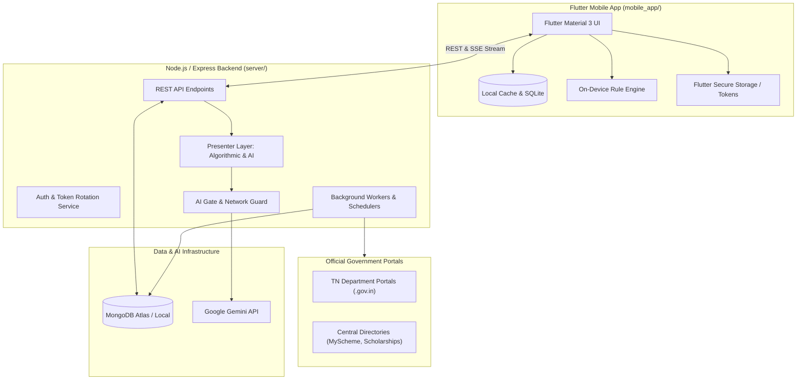

# TN Schemes & Pensions Finder

A comprehensive citizen platform built with **Flutter** (Mobile App) and **Node.js / Express** (Backend) with **MongoDB**, designed to help citizens of Tamil Nadu discover, check eligibility for, and navigate government welfare schemes and pensions.

The project combines **offline-capable on-device rule evaluation** with an **autonomous crawl & verification engine (Stage A: zero AI)** and an **evidence-grounded presentation layer (Stage B)**.

---

## Key Features

- **Progressive Profile Flow (Mobile)**: 7 collapsible sections (Personal, Family, Education, Work & Income, Assets & Household, Health, and Additional details) with section completeness indicators, auto-save drafts, and intuitive input controls.
- **On-Device Offline Rule Engine**: Instantly matches citizen profiles against schemes without sending personal data to a remote server. Respects strict eligibility criteria (active government servants vs. retired pensioners, income thresholds, marital status, community, and landholding).
- **Dual Authentication & Privacy-First**:
  - **Guest Mode**: Full functionality without creating an account (uses an anonymous `deviceId`).
  - **User Accounts**: JWT Access Tokens + SHA-256 rotating Refresh Tokens, bcrypt password hashing, account lockout protection, and one-click guest data migration upon sign-in.
  - **Zero PII**: No Aadhaar numbers, phone numbers, or residential addresses are ever gathered or stored.
- **Two-Stage Architecture (Stage A Zero AI & Stage B Grounded Display)**:
  - **Stage A (Fetch & Extract)**: Scrapes official `.gov.in` and `.nic.in` state portals deterministically. Enforces the **Quote Rule** (every stored fact must be a verbatim substring quote from the source). Hard-blocked from calling AI models via an internal `aiGate` and `networkGuard`.
  - **Stage B (Presentation)**: Algorithmic presenter converts stored facts into standardized Indian number formats (e.g. `₹1,00,000`, `₹25 lakh`), structured eligibility bullets with cited quotes, and clean application steps. Optional AI presenter translates/simplifies verified facts without hallucinating external numbers or promises.
- **Multimodal AI Scheme Finder**: Citizens can upload photos of notices, newspaper clippings, PDFs, or web links to extract criteria and test their eligibility using Google Gemini Vision.
- **Resilient AI Chat Assistant**: Integrated conversational assistant grounded strictly in stored scheme data, with fallback to keyword extraction, automatic exponential backoff, and model failovers (`gemini-3.5-flash` to `gemini-3.5-flash-lite`).
- **Real-Time Data Sources & Department Coverage**: Live monitoring of 15+ Tamil Nadu departments, worker welfare boards, scholarship portals, and central directories with transparency dashboards.

---

## System Architecture



---

## Repository Structure

```
scheme/
├── mobile_app/                  # Flutter mobile client
│   ├── assets/                  # Starter schemes bundle & offline data
│   ├── lib/
│   │   ├── models/              # Scheme, Discovery, UserProfile models
│   │   ├── providers/           # State management (Auth, Scheme fetch)
│   │   ├── screens/             # Dashboard, Profile, Finder, Chat, Sources
│   │   ├── services/            # ApiService, RuleEngine, TokenStorage
│   │   └── widgets/             # Verification badges, dialogs, custom cards
│   └── test/                    # Unit and widget test suite
├── server/                      # Node.js backend & crawler engine
│   ├── config/                  # Allowed domains & source allowlists
│   ├── data/                    # Seed and starter scheme JSON definitions
│   ├── lib/                     # aiGate, networkGuard, presenter, gemini client
│   ├── models/                  # Mongoose models (Scheme, User, Fact, Cache)
│   ├── recipes/                 # Domain-specific web scraping recipes
│   ├── routes/                  # Express routes (auth, schemes, chat, finder)
│   ├── scrapers/                # ScraperEngine, Table, Detail & PDF adapters
│   ├── services/                # Crawler, discovery, verification & search
│   └── tests/                   # Backend unit and integration tests
├── docs/                        # Project specifications & architecture notes
├── .gitignore                   # Ignore rules for secrets, builds & logs
└── README.md                    # Project documentation
```

---

## Getting Started & How to Run

### Prerequisites

- **Node.js**: v18.0 or higher
- **MongoDB**: Local MongoDB instance running on `mongodb://127.0.0.1:27017` or a MongoDB Atlas connection URI
- **Flutter SDK**: 3.24+ (Channel stable)
- **Android Studio / Android SDK** (for running on Android devices/emulators) or Google Chrome (for web testing)
- **Google Gemini API Key**: (Optional, needed for Vision Finder & Chat Assistant)

---

### 1. Setting Up the Backend Server

1. Open your terminal and navigate to the `server/` directory:
   ```bash
   cd server
   ```

2. Install dependencies:
   ```bash
   npm install
   ```

3. Configure your environment variables:
   Copy `.env.example` to `.env`:
   ```bash
   cp .env.example .env
   ```
   *Edit `.env` and configure your MongoDB URI and Gemini API key if available:*
   ```env
   PORT=3000
   MONGODB_URI=mongodb://127.0.0.1:27017/tn_schemes
   GEMINI_API_KEY=your_gemini_api_key_here
   JWT_SECRET=your_super_secret_jwt_key
   ```

4. Seed initial Tamil Nadu schemes database:
   ```bash
   npm run seed
   ```

5. Start the backend development server:
   ```bash
   npm run dev
   ```
   The backend API will run on `http://localhost:3000` (or your configured `PORT`).

6. Run backend test suite (optional):
   ```bash
   npm test
   ```

---

### 2. Setting Up the Flutter Mobile App

1. In a new terminal window, navigate to the `mobile_app/` directory:
   ```bash
   cd mobile_app
   ```

2. Fetch Flutter packages:
   ```bash
   flutter pub get
   ```

3. Connect your Android device or start an emulator:
   Check connected devices:
   ```bash
   flutter devices
   ```

4. Run the app:
   - **On connected Android Phone/Emulator**:
     ```bash
     flutter run
     ```
   - **On Web (Chrome)**:
     ```bash
     flutter run -d chrome
     ```
   - **On Windows Desktop**:
     ```bash
     flutter run -d windows
     ```

> **Note on Connecting from a Physical Device**:
> When running the Flutter app on a physical Android phone connected via USB, make sure the app points to your computer's local IP address (e.g. `http://192.168.1.X:3000`) instead of `localhost`. You can set this easily in the app's Developer/Server Address dialog on the dashboard.

---

## Running Background Crawlers & Verification (Admin)

The backend includes autonomous background verification tools that scrape official portals to confirm scheme terms and detect changes:

```bash
cd server

# Test network accessibility and TLS status of official portals
npm run sources:test

# Run single-pass verification over all active schemes
npm run verify:once

# Run audit on scheme facts completeness
npm run audit:schemes
```

---

## Security & Privacy Guidelines

- **Environment Separation**: API keys, database credentials, and session secrets are stored in `.env` files and **never** committed to version control.
- **Data Minimization**: The application stores only an email address and hashed passwords for authenticated accounts. It purposefully does not collect Aadhaar numbers, phone numbers, or addresses.
- **Hardware-Backed Token Security**: On mobile devices, authentication tokens are stored securely using `flutter_secure_storage` with Android Keystore encryption.
