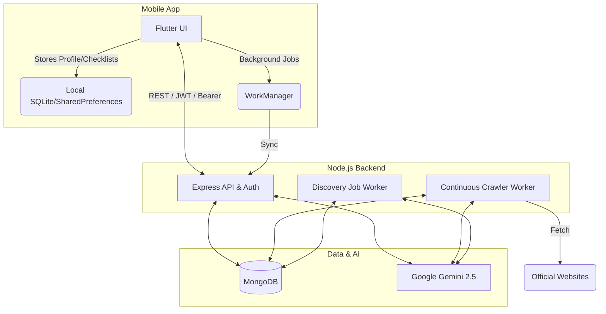

# TN Schemes & Pensions Finder

A mobile application built with Flutter and Node.js that helps citizens of Tamil Nadu discover and verify their eligibility for government schemes and pensions.

## Features
*   **Redesigned Progressive Profile Flow:** 7 collapsible sections (Personal details, Family, Education, Work & income, Assets & household, Health, Additional details) with section completeness indicators ("3 of 5 answered"), progress bar header, CheckboxListTile controls, short hints, auto-save draft, fixed bottom bar ("Save profile" / "Back to dashboard"), and unsaved changes dialog.
*   **On-Device Rule Engine:** Automatically matches your profile against a built-in database of schemes instantly, with strict rules for active government employees (Not Eligible), retired government pensioners with pensions (Possibly Eligible - Verify with note), income range limits near threshold, and missing data tracking.
*   **Profile-Driven AI Discovery:** Background worker automatically searches official government portals for new schemes matched to your profile, with extended query support for retired government employees, pensioners, farmers, students, and unorganised workers.
*   **Guest & Registered Accounts:** Use anonymously with an auto-generated device ID or register an account to sync your discoveries and checklists across devices.
*   **AI Scheme Finder:** Upload photos, PDFs, or web links of new schemes. The app uses Google Gemini Vision to extract criteria and check if you are eligible.
*   **Resilient AI Assistant Chat:** Powered by Gemini with automatic exponential backoff retries, backup model fallback (`gemini-3.5-flash-lite`), line-buffered SSE streaming, non-streaming `/api/chat/simple` fallback, developer server settings with connection diagnostic tests, and precise user-friendly error messages with retry options.
*   **Privacy-First:** Data minimization strictly enforced. No Aadhaar, phone numbers, addresses, or sensitive personal identity numbers are ever stored.

## Architecture



## Authentication & User Accounts

The backend supports dual-mode access:
1. **Guest Mode (Default)**: Requests use an anonymous `deviceId` (`x-device-id` header or query string). No registration or login required.
2. **User Account Mode**: Registered users authenticate using JWT Access Tokens (`15m` expiry) and SHA-256 hashed Refresh Tokens (`30d` expiry).

### Security Highlights
* **Data Minimization**: Stores ONLY email, bcrypt password hash (cost 12), and an optional display nickname. **NO** Aadhaar, phone number, address, or PII.
* **Token Rotation & Reuse Detection**: Refresh tokens are single-use per rotation. Presenting a previously revoked or used refresh token triggers automatic revocation of **all** sessions for that user.
* **Account Lockout**: 5 consecutive failed login attempts lock the account for 15 minutes.
* **Password Policy**: Minimum 8 characters, requiring at least 1 letter and 1 number. Rejects common weak passwords.
* **Cascading Account Deletion**: Deleting an account (`DELETE /api/auth/me`) permanently removes the user and ALL associated data (profiles, discoveries, chat history, checklists, tracker applications).

### Guest Data Claiming
When a guest user registers or logs in, they can migrate all anonymous data created under their `deviceId` to their user account:
`POST /api/auth/claim-guest-data { "deviceId": "<UUID>" }`
* Claims guest records without duplicates.
* Each `deviceId` can be claimed **only once**.

### Password Reset & SMTP Configuration
Password reset tokens are single-use, hashed with SHA-256, and expire in 30 minutes.
- **Production / SMTP**: Configure SMTP settings in `.env`.
- **Development Console Fallback**: If SMTP is not configured (`SMTP_HOST` omitted) and `NODE_ENV !== 'production'`, password reset links are logged directly to the server console:
  `[DEV] Password reset link for user@example.com: http://localhost:3000/reset-password?token=...`

#### `.env` Settings for SMTP & Auth:
```env
JWT_SECRET=your_jwt_secret_key_change_in_production
APP_BASE_URL=http://localhost:3000
ALLOWED_ORIGINS=http://localhost:3000,http://10.0.2.2:3000

# SMTP Email Settings
SMTP_HOST=smtp.example.com
SMTP_PORT=587
SMTP_USER=your_smtp_username
SMTP_PASS=your_smtp_password
MAIL_FROM=noreply@tn.gov.in
```

---

## Auth Endpoints Reference

| Endpoint | Method | Auth | Description |
|---|---|---|---|
| `/api/auth/signup` | POST | None | Create account & receive tokens. |
| `/api/auth/login` | POST | None | Authenticate with generic failure message & lockout protection. |
| `/api/auth/refresh` | POST | None | Rotate refresh token and issue new access token. |
| `/api/auth/logout` | POST | None | Revoke single refresh token. |
| `/api/auth/logout-all` | POST | Bearer | Revoke all active sessions for user. |
| `/api/auth/forgot-password` | POST | None | Request reset email / dev console link. |
| `/api/auth/reset-password` | POST | None | Reset password with single-use 30m token. |
| `/api/auth/me` | GET | Bearer | Fetch user profile info (`email`, `displayName`, `createdAt`). |
| `/api/auth/me` | PATCH | Bearer | Update nickname `displayName`. |
| `/api/auth/change-password` | POST | Bearer | Update password & revoke other sessions. |
| `/api/auth/me` | DELETE | Bearer | Cascade delete user account and ALL user data. |
| `/api/auth/claim-guest-data` | POST | Bearer | Transfer guest `deviceId` data to logged-in user. |

---

## Flutter Mobile App Auth Architecture

The Flutter mobile application (`mobile_app/`) provides complete authentication, token management, guest mode, and account migration:

### 1. Token Persistence & Security
* **`TokenStorageService`**: Stores JWT Access and Refresh tokens exclusively in `flutter_secure_storage` using `AndroidOptions()` for hardware-backed encryption where available. Fallbacks gracefully to SharedPreferences in test/emulator environments.
* **Zero Logging Policy**: Password strings and access/refresh tokens are **never** logged or printed to output streams or debug logs.

### 2. Dio Interceptor (`DioClient`)
* **Automatic Auth Header**: Attaches `Authorization: Bearer <access_token>` and `x-device-id: <deviceId>` to outgoing requests.
* **Queued 401 Refresh Handler**: Intercepts `401 Unauthorized` responses once. Automatically triggers `POST /api/auth/refresh` using the refresh token, updates stored tokens, retries the original request, and queues subsequent requests during rotation.
* **Loop Prevention & Clean Logout**: Prevents infinite 401 loops by flagging retried requests. On refresh failure or token revocation, clears stored tokens, switches to Guest Mode, and notifies `AuthProvider` for clean state reset.

### 3. App Screens & Flow
* **`WelcomeScreen`**: Presented on first launch with options: "Sign up", "Log in", or "Continue without an account" (guest mode). Guest decision is remembered locally, showing a prompt banner on the Profile tab to register for cross-device sync.
* **`SignUpScreen`**: Email, password (show/hide toggle, strength meter hint), password confirmation, optional nickname, and mandatory privacy note checkbox. Inline validation errors under fields.
* **`LogInScreen`**: Email, password (show/hide toggle), "Forgot password?" link, and Sign Up navigation. Friendly error handling for invalid credentials, connection issues, and account lockouts (15-minute timer).
* **`ForgotPasswordScreen` & `ResetPasswordScreen`**: Reset email link request and password reset with token input.
* **`AccountScreen`**: Email display, editable nickname, password change dialog, log out, log out of all devices, and account deletion with password verification.
* **`PrivacyNoteDialog`**: Transparent notice confirming only email and bcrypt password hash are stored—never Aadhaar, phone numbers, or addresses.
* **Guest Data Claiming**: After signing in, prompts users to claim local guest data (`POST /api/auth/claim-guest-data`) to sync local profiles and saved schemes with their account.

### 4. Running Tests
Run full unit and widget test suite for form validations, interceptor token refresh, guest data claiming, and logout token cleanup:
```bash
cd mobile_app
flutter test
```

---

## Deployment & Hosting

This app is designed to run on a standard Node.js server with MongoDB. 

**Free Tier Hosting (Render / Railway):**
If deploying the backend to a host that sleeps when idle (e.g. Render free tier), the continuous `Crawler Worker` will sleep and miss its cron schedules. To prevent this, set up an external cron ping (like UptimeRobot) to hit the `GET /api/health` endpoint every 10 minutes.

**Database:**
Use MongoDB Atlas (free tier is sufficient).

## Data Pipeline & Trust Rules
The backend features an always-on scheduler that crawls official domains.
*   **Official & Reputable Sources:** Can create or update scheme records automatically.
*   **Signal-Only (News):** Only triggers alerts for admins to re-check official sources.
*   **Content Hashing:** The crawler hashes page text and only invokes the Gemini API if the hash changes, massively reducing LLM costs.

## Known Limitations
*   The built-in rules are simplified representations and may not cover edge cases.
*   The AI Finder relies on the quality of the uploaded document/image and may occasionally misinterpret criteria.
*   Does not support direct application submission; it only guides users to official portals and e-Sevai centres.
*   **Crawling Limits:** The live data pipeline relies on official websites remaining accessible.

