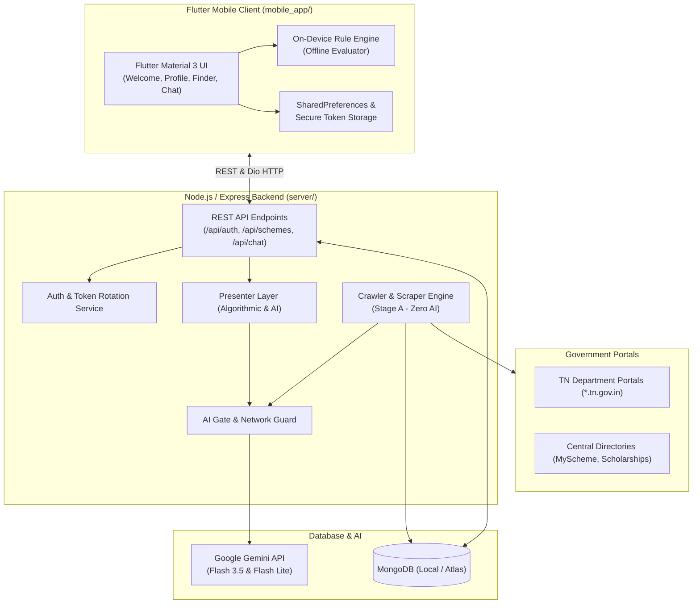

# Thittam - TN Schemes & Pensions Finder

A citizen-first government welfare scheme discovery and eligibility platform built with **Flutter** (Mobile App) and **Node.js / Express** (Backend API & Scraper Engine) with **MongoDB**.

**Thittam** helps citizens of Tamil Nadu discover welfare schemes, check eligibility rules on-device with zero data tracking, calculate potential pensions, and access verified application steps grounded directly in official state government portals.

---

## 🌟 Key Features

- **🏛️ Modern Brand Experience**:
  - Clean initial screen with the official Thittam emblem.
  - Three distinct entry points on opening: **Log in**, **Sign up**, or **Continue without an account** (instant Guest Mode).
  - Both Login and Sign Up screens also offer direct access to Guest Mode.
- **📱 Progressive Citizen Profile**:
  - 7 structured sections: Personal details, Family & Marriage, Education, Work & Income, Assets & Household, Health & Disability, and Additional details.
  - Section completeness meters, draft autosaving, and bilingual support (English & Tamil).
- **🔒 Privacy-First On-Device Rule Engine**:
  - Matches profiles against welfare rules locally in the Flutter app.
  - Categorizes schemes into **Eligible**, **Near-Eligible / Missing Fields**, and **Ineligible**.
  - No personal identification info (PII) like Aadhaar, phone numbers, or residential addresses is ever collected or stored.
- **🛡️ Two-Stage Verification Architecture**:
  - **Stage A (Fetch & Extract - Zero AI)**: Autonomous crawler extracts facts only from official `.gov.in` and `.nic.in` domains with strict adherence to the **Quote Rule** (every fact must be a verbatim substring quote from the government source). Hard-gated against external AI calls.
  - **Stage B (Grounded Presentation Layer)**: Formats verified facts into standardized Indian numbering (`₹1,00,000`, `₹25 lakh`), bullet points, and step-by-step guidance without hallucination.
- **📸 Multimodal AI Scheme Finder**:
  - Citizens can take pictures or upload photos of newspaper clippings, public notices, PDFs, or enter web links to parse eligibility terms with Google Gemini Vision.
- **💬 Conversational Scheme Assistant**:
  - Interactive AI chat strictly grounded in verified database facts with automatic failover and Tamil language support.
- **🔄 Account Flexibility**:
  - Supports anonymous guest usage using local storage.
  - Optional account creation with JWT access tokens, rotating refresh tokens, and seamless one-click guest data migration.

---

## 🏗️ System Architecture



---

## 📂 Project Structure

```
scheme/
├── mobile_app/                  # Flutter Mobile Client (iOS, Android, Web, Desktop)
│   ├── assets/                  # Starter scheme definitions & offline JSON bundles
│   ├── lib/
│   │   ├── models/              # UserProfile, Scheme, Discovery models
│   │   ├── providers/           # State management (AuthProvider, LanguageProvider, SchemeFetchProvider)
│   │   ├── screens/             # WelcomeScreen, LogInScreen, SignUpScreen, DashboardScreen, ProfileScreen, FinderScreen, ChatScreen
│   │   ├── services/            # ApiService, DioClient, RuleEngine, TokenStorageService
│   │   └── widgets/             # AppLogo, ServerAddressDialog, VerificationBadge, RecentlyChangedBanner
│   └── test/                    # Automated widget and unit test suites
├── server/                      # Node.js / Express Backend & Scraper Engine
│   ├── config/                  # Allowed domains & source definitions
│   ├── data/                    # Seed data & static starter scheme JSON
│   ├── lib/                     # aiGate, networkGuard, presenter, ruleChatAssistant, geminiClient
│   ├── models/                  # Mongoose models (Scheme, User, Fact, SchemeCache)
│   ├── recipes/                 # Domain-specific web scraping recipes
│   ├── routes/                  # Express route handlers (auth, schemes, chat, finder, admin)
│   ├── scrapers/                # ScraperEngine, TableAdapter, DetailAdapter, PdfAdapter
│   ├── services/                # Crawler, discovery, verification & search services
│   └── tests/                   # Backend unit, integration & resilience test suites
├── docs/                        # Architecture documentation & design notes
├── .gitignore                   # Ignore rules for node_modules, Flutter build, .env & logs
└── README.md                    # Project overview and run guide
```

---

## 🚀 Getting Started & How to Run

### Prerequisites

Ensure you have the following installed on your system:
- **Node.js**: `v18.0.0` or higher ([Download Node.js](https://nodejs.org/))
- **MongoDB**: Community Server running locally on `mongodb://127.0.0.1:27017` or a MongoDB Atlas connection string ([Download MongoDB](https://www.mongodb.com/try/download/community))
- **Flutter SDK**: `v3.24.0` or higher ([Download Flutter](https://flutter.dev/docs/get-started/install))
- **Git**

---

### Step 1: Start the Backend Server

1. Open your terminal and change into the `server/` directory:
   ```bash
   cd server
   ```

2. Install dependencies:
   ```bash
   npm install
   ```

3. Configure environment variables:
   Copy `.env.example` to create `.env`:
   ```bash
   # On Windows (PowerShell):
   Copy-Item .env.example .env

   # On Linux / macOS:
   cp .env.example .env
   ```

   Open `.env` in any text editor and adjust settings if desired:
   ```env
   PORT=3000
   MONGODB_URI=mongodb://127.0.0.1:27017/tn_schemes
   GEMINI_API_KEY=your_gemini_api_key_here
   JWT_SECRET=your_jwt_secret_key_change_in_production
   ```
   *(Note: A Gemini API key is optional for standard usage; the core rules and local schemes function fully offline without AI).*

4. Seed the database with starter Tamil Nadu welfare schemes:
   ```bash
   npm run seed
   ```

5. Start the backend server:
   ```bash
   npm start
   # or with live reloading / development flags:
   npm run dev
   ```
   The backend API will be live at `http://localhost:3000`.

---

### Step 2: Run the Flutter Mobile App

1. Open a new terminal window and navigate to `mobile_app/`:
   ```bash
   cd mobile_app
   ```

2. Install Flutter dependencies:
   ```bash
   flutter pub get
   ```

3. Launch the app on your preferred target:

   - **Web (Google Chrome)**:
     ```bash
     flutter run -d chrome
     ```

   - **Android Emulator / Connected Device**:
     ```bash
     flutter run -d android
     ```

   - **Windows Desktop**:
     ```bash
     flutter run -d windows
     ```

> 💡 **Connecting a Physical Phone via Wi-Fi**:
> If running on a physical Android device, ensure your phone and computer are on the same Wi-Fi network. In the app, tap the **Server Settings** icon (ethernet icon in the top right of the Login/Signup screen) and set the server URL to your machine's local IP (e.g., `http://192.168.1.15:3000`).

---

## 🧪 Running Tests

### Mobile App Tests (Flutter)
```bash
cd mobile_app
flutter test test/auth_widget_test.dart
```

### Backend Tests (Node.js & Jest)
```bash
cd server
npm test
```

---

## 🔒 Security & Privacy Practices

- **Zero PII Policy**: No government ID numbers (Aadhaar, Voter ID), phone numbers, or precise addresses are ever requested or stored.
- **Protected Secrets**: `.env` files and certificates are excluded via [`.gitignore`](file:///c:/Users/mohan%20prasath%20kg/Desktop/scheme/.gitignore).
- **Secure Tokens**: Session tokens are encrypted on mobile using device hardware keystores (`flutter_secure_storage`).
- **Cryptographic Password Hashing**: Passwords are saved using salt-based bcrypt hashing.
